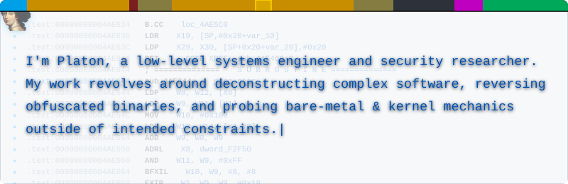
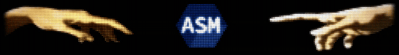

  <picture>
    <source media="(prefers-color-scheme: dark)" srcset="./svg/ida-v3-dark.svg">
    
  </picture>

  <picture>
    <source type="image/webp" srcset="./assets/asm-art.webp">
    
  </picture>

  <a href="https://t.me/ReverseEng1neer">
    
    &nbsp;<b>@ReverseEng1neer</b>
  </a>

  <i>"Understanding a system truly begins when you step outside of its intended constraints."</i>

